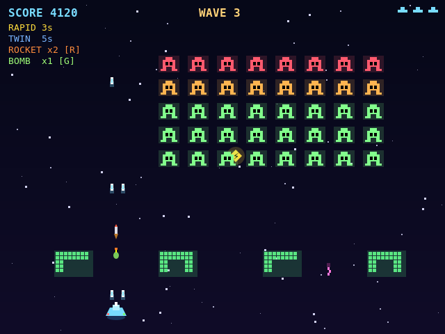
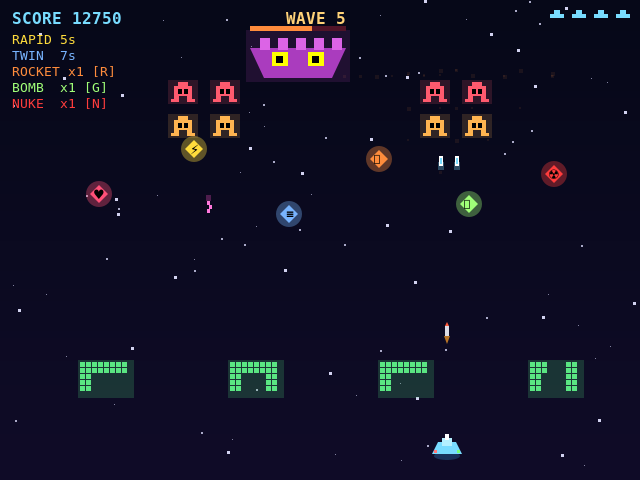

# Space Invaders (Java)

Классическая аркада **Space Invaders** на Java Swing — без внешних зависимостей.
Корабль внизу, волны пришальцев сверху, босс в конце волн, система бонусов.


## Скриншоты

| Игровой процесс | Босс + бонусы |
|---|---|
|  |  |
| Сетка 8×5, пули, ракета, щиты с пробоинами | Босс с полосой HP, все типы бонусов в воздухе |

## Возможности

- **Сетка 8×5** пришальцев: движение влево-вправо, опускание при развороте, ускорение с волнами
- **Босс** в самом верху: появляется при ≤8 пришальцев, 20 HP, полоса здоровья
- **4 разрушаемых щита** (пиксельная эрозия)
- **Система бонусов** (дроп 12%):

  | Бонус | Клавиша | Эффект |
  |-------|---------|--------|
  | ♥ Сердечко | — | +1 жизнь (макс. 5) |
  | ⚡ Скорострельность | — | Выстрел каждые 6 кадров, 10 сек |
  | ≡ Двойной пулемёт | — | Два параллельных выстрела, 12 сек |
  | 🚀 Ракеты | `R` | +3 ракеты, взрыв по радиусу 40px |
  | 💣 Гранаты | `G` | +2 гранаты, взрыв по радиусу 30px |
  | ☢ Ядерное оружие | `N` | Уничтожает всех, белая вспышка + тряска |

- **Эффектный взрыв корабля**: 60+ частиц, осколки, тряска экрана
- Звёздное небо с параллаксом, градиентный фон, частицы с затуханием

## Управление

| Клавиша | Действие |
|---------|----------|
| ← / →   | Движение корабля |
| SPACE   | Выстрел |
| R       | Ракета |
| G       | Граната |
| N       | Ядерное оружие |
| P       | Пауза |
| ENTER   | Рестарт после Game Over |

## Сборка и запуск

### Требования
- JDK 17+ (для jar)
- Для нативной сборки: `jpackage` (входит в JDK 14+)

### Вариант 1: Gradle (рекомендуется)

```bash
# Fat-jar
./gradlew build
java -jar build/libs/space-invaders-java-1.0.0.jar

# Нативный бинарник (app-image)
./gradlew nativeImage
./build/jpackage/SpaceInvaders/bin/SpaceInvaders
```

### Вариант 2: напрямую через javac

```bash
javac -d out src/main/java/invaders/*.java
java -cp out invaders.Game
```

или `./run.sh`.

### Вариант 3: нативный AppImage

```bash
JP_TYPE=app-image ./gradlew nativeImage
# Результат: build/jpackage/SpaceInvaders/
```

## Структура проекта

```
├── build.gradle                  # Gradle: jar + jpackage
├── docs/                         # скриншоты для README и релиза
├── settings.gradle
├── gradlew                       # Gradle wrapper
├── run.sh                        # Быстрый запуск через javac
├── LICENSE
└── src/main/java/invaders/
    ├── Game.java                 # игровой цикл, ввод, HUD, бонусы
    ├── Player.java               # корабль игрока
    ├── Bullet.java               # пуля игрока
    ├── Rocket.java               # ракета (взрыв по площади)
    ├── Grenade.java              # граната (взрыв по площади)
    ├── PowerUp.java              # бонусы (6 типов)
    ├── Invader.java              # пришалец (2 кадра анимации)
    ├── InvaderGrid.java          # сетка + ИИ движения/стрельбы
    ├── EnemyShot.java            # выстрел пришальца
    ├── Boss.java                 # босс (20 HP)
    ├── Shield.java               # разрушаемый бункер
    ├── ParticleSystem.java       # эффекты взрывов
    └── StarField.java            # звёздное небо с параллаксом
```

## Архитектура

- **Game loop**: `Thread` с `sleep(16ms)` ≈ 60 FPS, `repaint()` каждый кадр
- **Рендер**: `Graphics2D` в `paintComponent`, антиалиасинг
- **Коллизии**: AABB (axis-aligned bounding box) для пуль/пришельцев/босса
- **Взрывы по площади**: расстояние от центра до каждого пришальца ≤ радиус
- **Бонусы**: список `PowerUp`, дроп при убийстве пришальца (12%), сбор кораблём
- **Тряска экрана**: смещение `Graphics2D.translate` на N кадров

## Лицензия

MIT — см. [LICENSE](LICENSE).
